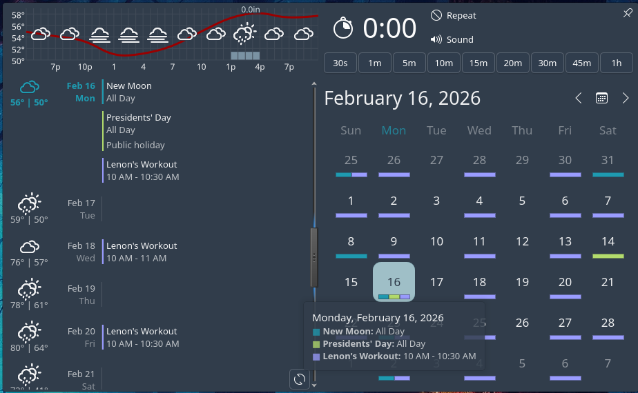
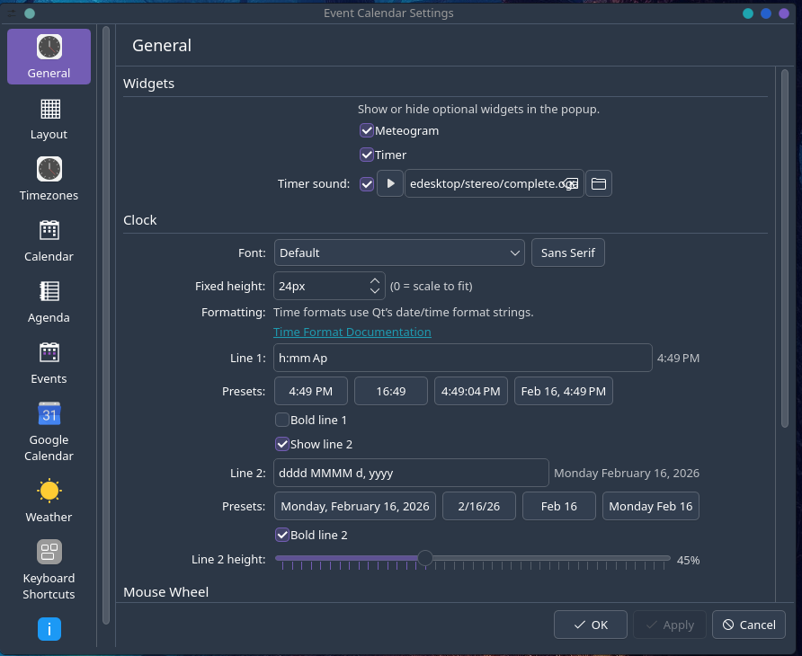
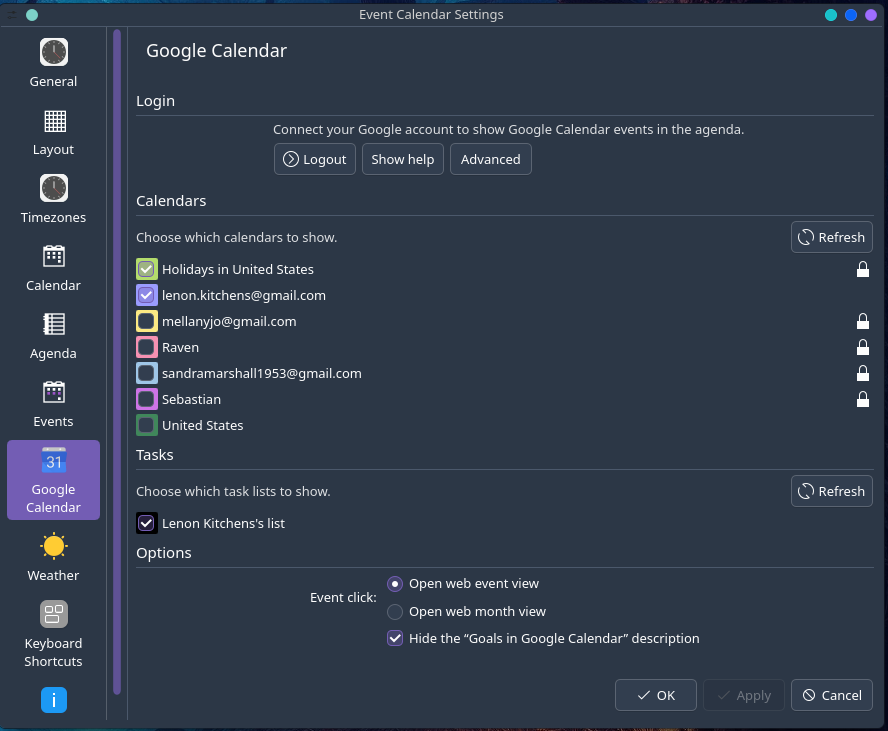
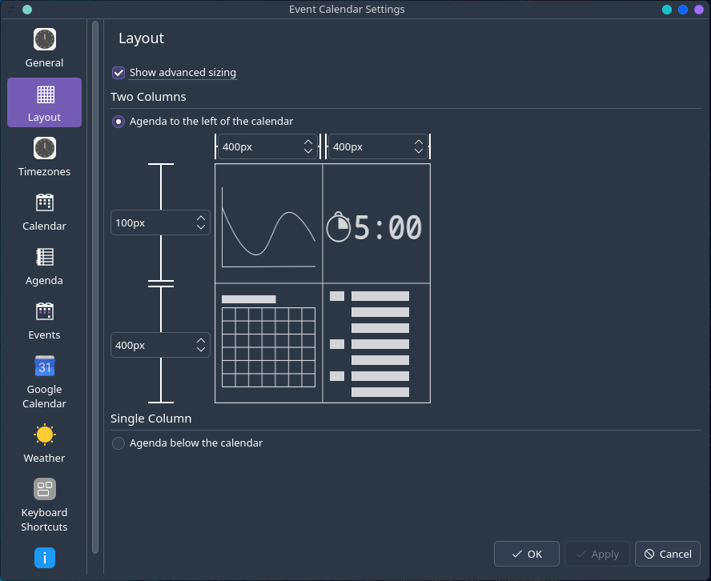

# Plasma 6 Event Calendar

A modern **Plasma 6** port and substantial rewrite of the classic Event Calendar plasmoid.

This widget combines:

- Calendar + month grid
- Agenda / upcoming events
- Tasks integration
- Weather integration
- Optional Google Calendar sync

## Credits

This project is based on the original **Event Calendar** by **Chris Holland (Zren)**.

- Original repository: <https://github.com/Zren/plasma-applet-eventcalendar>
- Original KDE Store page: <https://store.kde.org/p/998901/>

Huge credit to Zren/Chris Holland for creating and maintaining the original applet that this port builds upon.

## Screenshots






## Installation

### Option A: Install using included script (user-level, recommended)

This installs for the current user under `~/.local/share/plasma/plasmoids/`. No `sudo` needed.

```bash
git clone https://github.com/lenonk/plasma6-applet-eventcalendar.git
cd plasma6-applet-eventcalendar
./install.sh
```

The browser-based Google login requires the OAuth helper to compile. If the
build dependencies below are missing, the installer still installs the widget,
writes the reason to `cmake-build/build.log`, and the **Advanced** manual login
method remains available.

Don't mix this with a system-wide install (Option B or a distro package): the
scripts only manage the user-level copy.

### Option B: Build & install (system-wide)

For packagers. Installs under `/usr` and requires `sudo`.

```bash
git clone https://github.com/lenonk/plasma6-applet-eventcalendar.git
cd plasma6-applet-eventcalendar
cmake -S . -B build -DCMAKE_INSTALL_PREFIX=/usr
cmake --build build
sudo cmake --install build
```

### Build dependencies

CMake ≥ 3.16, a C++17 compiler, ECM, Qt 6 NetworkAuth, KPackage, libplasma and
gettext (`msgfmt`; or configure with `-DEVENTCALENDAR_ENABLE_TRANSLATIONS=OFF`).
Package names vary by release:

| Distro | Packages |
|---|---|
| Arch | `cmake extra-cmake-modules qt6-networkauth kpackage libplasma gettext` |
| Fedora | `cmake extra-cmake-modules gcc-c++ qt6-qtnetworkauth-devel kf6-kpackage-devel libplasma-devel gettext` |
| Debian / Ubuntu / Neon | `cmake extra-cmake-modules g++ qt6-networkauth-dev libkf6package-dev libplasma-dev gettext` |
| openSUSE | `cmake kf6-extra-cmake-modules gcc-c++ qt6-networkauth-devel kf6-kpackage-devel libplasma6-devel gettext-tools` |

Runtime: Qt 6 Qt5Compat (GraphicalEffects), plasma5support and plasma-workspace.
Optional: kdepim-addons (local calendars), plasma-nm (connectivity detection),
python-gobject + libnotify + libcanberra (notifications and sounds),
python-icalendar (iCal sources), qt6-positioning + geoclue (weather **Detect
location** button).

### Option C: Arch Linux (AUR)

Also available in the AUR as:

- `plasma6-applets-eventcalendar`

You can install it with your preferred AUR helper, for example:

```bash
yay -S plasma6-applets-eventcalendar
```

## Updating

```bash
./update.sh
```

This pulls the latest changes and reinstalls the applet.

## Uninstall

```bash
./uninstall.sh
```

## Configuration

After installing:

1. Open the widget settings for Event Calendar.
2. Configure calendar providers (local / Google) as needed.
3. Configure weather provider (Open-Meteo) and location.
4. Apply changes.

### Google Calendar setup

1. Open **Event Calendar Settings → Google Calendar**.
2. Enter your Google OAuth Client ID (and optional Client Secret).
3. Click **Login in Browser** and complete authentication.
4. Click **Apply**.

## Troubleshooting

### Timer sound is silent (PipeWire / WirePlumber)

If the timer notification appears but its sound never plays, WirePlumber may
have persisted the notification audio role as muted. Check
`~/.local/state/wireplumber/stream-properties` for
`Output/Audio:media.role:Notification={"mute":true,...}`.

To fix it, unmute the stream while a notification sound is playing, either in
Plasma's volume mixer or with `pactl list sink-inputs` then
`pactl set-sink-input-mute <sink-input-id> 0`. WirePlumber then saves
`"mute":false` itself. Don't edit the state file while WirePlumber is running.

### Mouse wheel volume does nothing

Older versions used `qdbus`, which most Plasma 6 distros no longer install.
Click the **Volume (D-Bus)** preset under **General → Mouse Wheel** to switch to
`dbus-send`, which ships with D-Bus itself.

## Notes

- This is a community-maintained Plasma 6 continuation/port.
- If you are migrating from older Plasma 5 builds, review settings after upgrade.

## License

See project license files and upstream licensing notes from the original project.

## Support

[](https://ko-fi.com/K3K51TO6S1)
